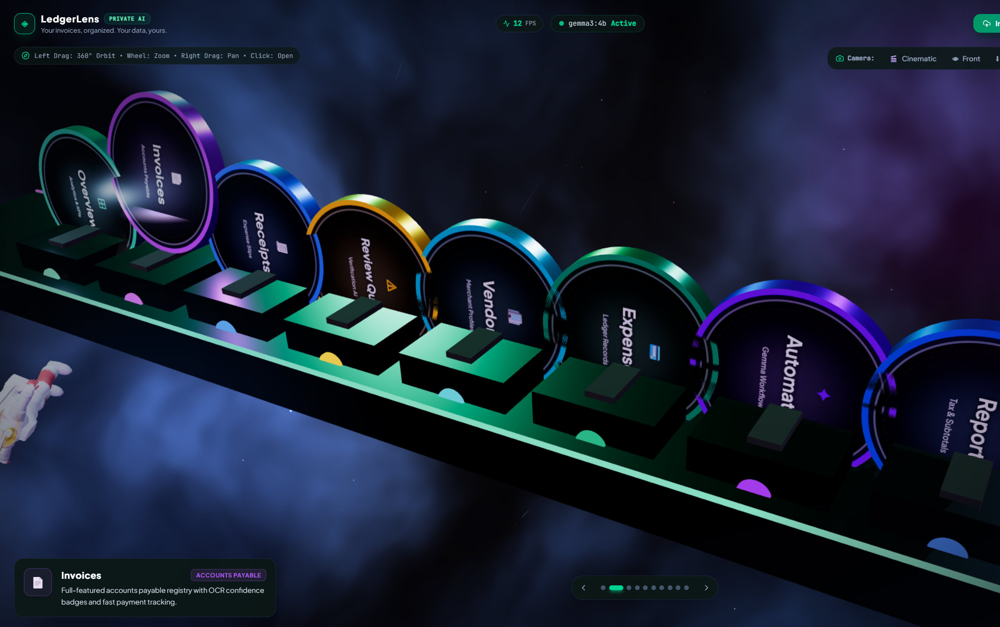
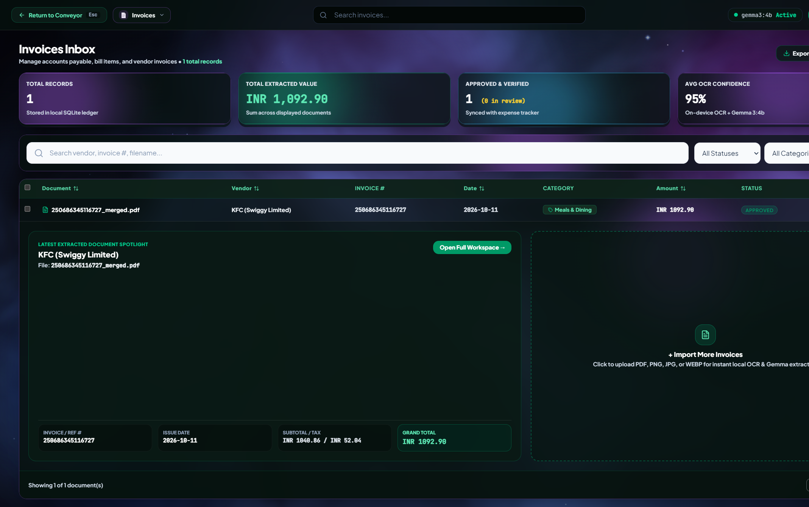
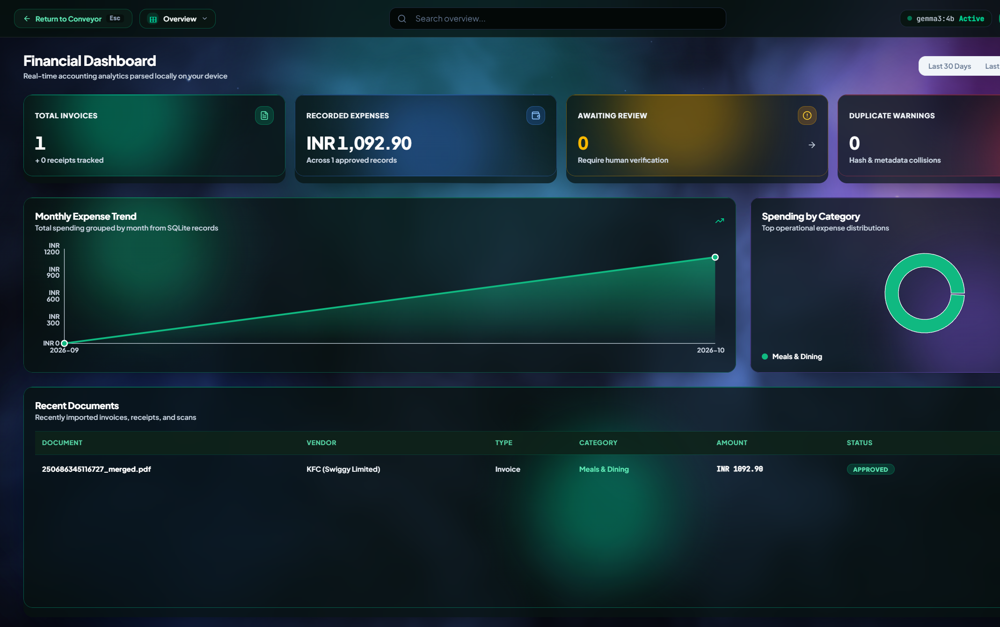
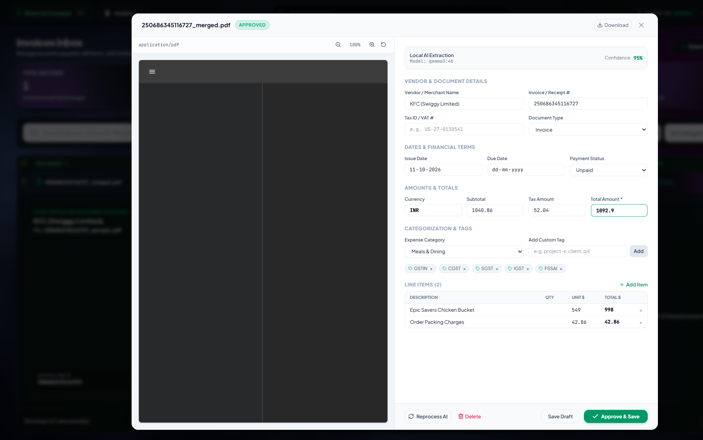
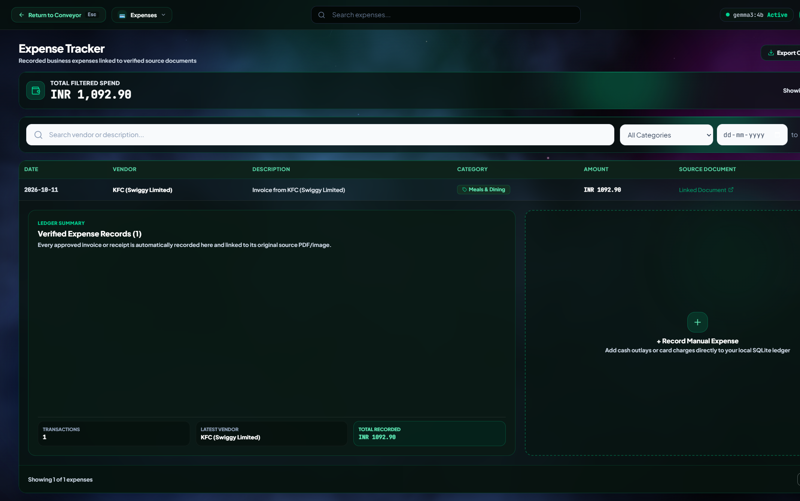
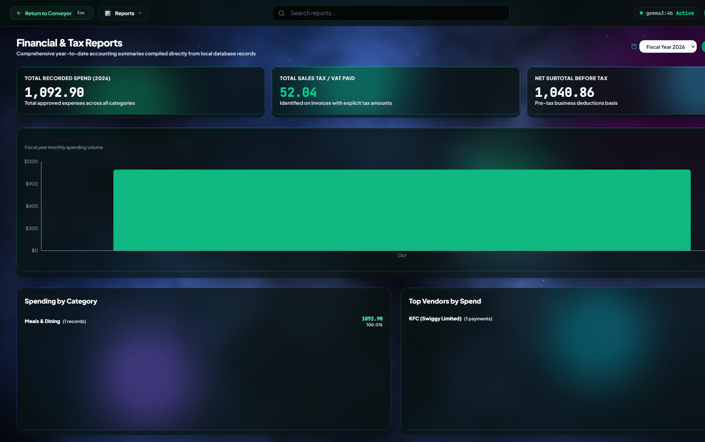
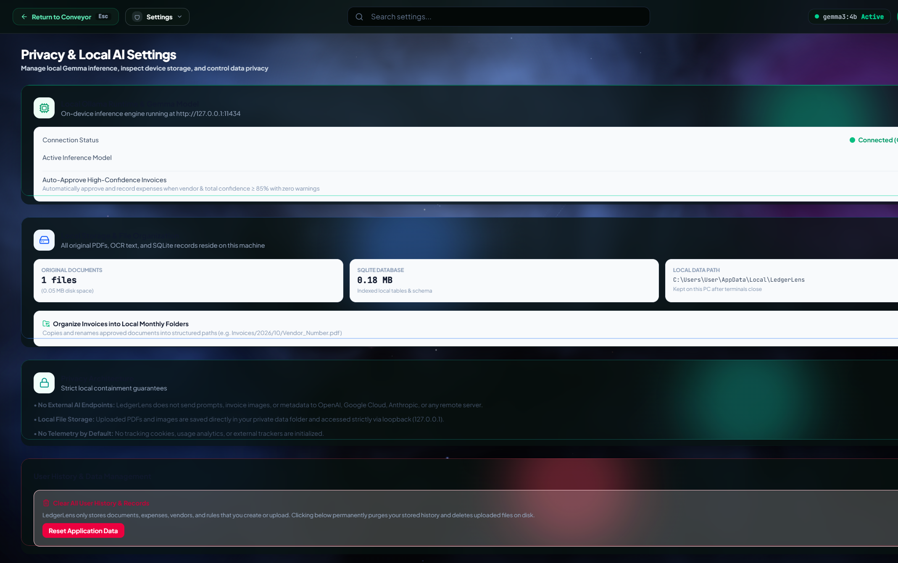
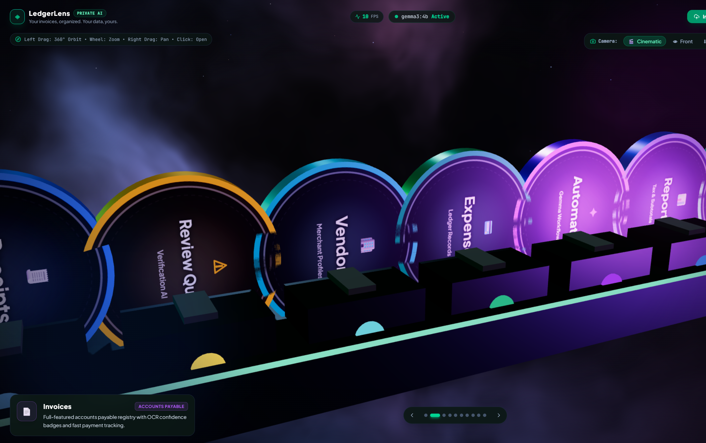

# LedgerLens

**Your invoices, organized. Your data, yours.**

Local-first invoice and expense workspace. Upload a PDF or photo, extract it on-device with Gemma 3 via Ollama, then review, approve, and track spend — without sending documents to a cloud AI.

<p align="center">
  
</p>

<p align="center">
  <em>State A — 10 feature coins on a 3D conveyor. Click a coin to open its full-screen workspace.</em>
</p>

[%20via%20Ollama-emerald?style=flat-square)](https://ollama.com)
[](#privacy)
[-blue?style=flat-square)](https://sqlite.org)
[](#3d-coin-conveyor)

---

## Product tour

| Invoices Inbox | Financial Dashboard |
| :---: | :---: |
|  |  |
| Search, filter, and fill the workspace with extracted invoices. | KPIs, monthly trend, category mix, and recent documents. |

| Human review | Expense ledger |
| :---: | :---: |
|  |  |
| Side-by-side source + structured fields, line items, and Approve & Save. | Approved invoices land here, linked back to the original file. |

| Tax reports | Privacy & local storage |
| :---: | :---: |
|  |  |
| Year-to-date spend, VAT, categories, and top vendors. | History stays on this PC — even after you close the terminals. |

---

## Who it is for

People who process invoices and receipts but do not want those files leaving the machine:

- **Freelancers and solopreneurs** — extract vendor, tax, and totals without retyping.
- **Small businesses** — accounts payable inbox, vendor spend, duplicate checks.
- **Bookkeepers** — human-in-the-loop review with confidence scores before anything is approved.

---

## Why local

Typical invoice SaaS uploads PDFs to a remote model. LedgerLens keeps inference, files, and the database on localhost.

| | Typical cloud SaaS | LedgerLens |
| :--- | :--- | :--- |
| Inference | Remote API | **Ollama + Gemma 3 (4B) on `127.0.0.1:11434`** |
| Files | Cloud object storage | **Local uploads folder** |
| Database | Multi-tenant cloud | **SQLite WAL on this PC** |
| Recurring AI cost | Tokens / subscription | **Unlimited local compute** |
| After you quit | Session in the cloud | **Ledger remains in `%LOCALAPPDATA%\LedgerLens` (Windows) or `~/.ledgerlens`** |

<p align="center">
  
</p>

<p align="center">
  <em>Each coin is a workspace — invoices, receipts, review, vendors, expenses, automation, reports, local AI, settings.</em>
</p>

---

## 3D coin conveyor

Navigation is a conveyor, not a sidebar.

```
[ 3D Coin Conveyor ]  -- click / Enter -->  [ Full-screen workspace ]
         ^                                          |
         +-------------- Esc / Return --------------+
```

- Nebula skybox, starfield, and a live 3D rack of 10 coins.
- Selecting a coin opens its workspace over the same cosmic background.
- Empty slots persist for the session; **Restore Coins** puts them back.

### Controls

| Action | Input |
| :--- | :--- |
| Orbit | Left-drag |
| Zoom | Wheel / pinch |
| Pan | Right-drag |
| Open workspace | Click coin or **Enter** |
| Slide rack | `←` `→` or `A` `D` |
| Camera presets | `1` cinematic · `2` front · `3` top · `4` isometric |
| Reset camera | `R` |
| Back to conveyor | `Esc` |
| Restore coins | `Alt+R` |

---

## Workspaces

| # | Coin | What you get |
| :---: | :--- | :--- |
| 1 | **Overview** | Spend KPIs, monthly trend, category donut, recent documents. |
| 2 | **Invoices** | AP inbox, OCR confidence, filters, bulk actions, CSV export. |
| 3 | **Receipts** | Same table pipeline, scoped to expense slips. |
| 4 | **Review Queue** | Low-confidence and duplicate items waiting for a human. |
| 5 | **Vendors** | Merchant profiles, lifetime spend, merge duplicates. |
| 6 | **Expenses** | Approved records linked to the source PDF/image. |
| 7 | **Automation** | AND/OR rules, plus a Gemma natural-language rule translator. |
| 8 | **Reports** | Annual totals, VAT, category and vendor breakdowns, CSV. |
| 9 | **Local AI** | Ollama status, model pick, latency test prompt. |
| 10 | **Settings** | Storage path, organize-into-folders, privacy, hard reset. |

The review modal is the verification step: original document on the left, extracted vendor / dates / tax / line items on the right. **Approve & Save** writes an expense row and updates vendor totals.

---

## Stack

**Frontend** — React 19, Vite 6, Tailwind CSS 4, Three.js, Recharts, Lucide.

**Backend** — Express, TypeScript (`tsx`), SQLite (`better-sqlite3`, WAL), Zod, Tesseract.js, `unpdf` / `pdf-parse`.

**Local AI** — Ollama at `http://127.0.0.1:11434`, default model `gemma3:4b`, JSON-schema extraction with OCR fallbacks.

History is stored on disk (not only in memory). Closing the terminals and running `npm run dev` again reloads the same invoices, expenses, and vendors. The UI also caches the last successful lists in `localStorage` so the inbox is not blank while the backend is starting.

---

## Getting started

### Prerequisites

- Node.js 20 or 22
- [Ollama](https://ollama.com) installed

```bash
ollama pull gemma3:4b
```

Ollama usually sits in the system tray. If it is not running:

```bash
ollama serve
```

### Install and run

```bash
git clone <this-repo>
cd ledgerlens   # or the folder you cloned
npm install
npm run dev
```

| Service | URL |
| :--- | :--- |
| Frontend | http://localhost:5173 |
| Backend | http://127.0.0.1:3001 |

Run them separately if you prefer:

```bash
npm run dev:backend
npm run dev:frontend
```

Data directory (created automatically):

- **Windows:** `%LOCALAPPDATA%\LedgerLens`
- **macOS / Linux:** `~/.ledgerlens`

Override with `DATA_DIR` in a repo-root `.env` (see `.env.example`). Relative paths are resolved from the repo root, not the terminal’s current folder.

### Tests and build

```bash
npm run test
npm run build
```

---

## Privacy

1. Express binds to `127.0.0.1` by default — no WAN listen.
2. Prompts and invoice images are not sent to OpenAI, Google Cloud, Anthropic, or other remote extractors.
3. OCR text is treated as untrusted input; extraction uses a strict JSON schema.
4. CSV exports escape formula-injection prefixes (`=`, `+`, `-`, `@`).
5. Uploads are UUID-renamed and restricted to PDF / PNG / JPEG / WEBP.

Settings → **Reset Application Data** is the only way to wipe the local ledger (type `RESET_ALL_DATA` to confirm).

---

## API (loopback)

| Method | Path | Purpose |
| :---: | :--- | :--- |
| `GET` | `/api/health` | Process + SQLite health |
| `GET` | `/api/ollama/status` | Local model discovery |
| `POST` | `/api/documents/upload` | Multi-file upload + background extraction |
| `GET` | `/api/documents` | Paginated inbox |
| `GET` / `PUT` | `/api/documents/:id` | Detail / human corrections |
| `POST` | `/api/documents/:id/approve` | Approve and create expense |
| `GET` | `/api/expenses` | Expense ledger |
| `GET` | `/api/vendors` | Merchant directory |
| `POST` | `/api/vendors/merge` | Merge duplicate vendors |
| `GET` / `POST` | `/api/rules` | Automation rules |
| `POST` | `/api/rules/assistant` | Natural-language rule from Gemma |
| `GET` | `/api/export/csv` | Sanitized spreadsheet |
| `POST` | `/api/export/organize` | Copy approved files into `Invoices/YYYY/MM/` |

---

## License

MIT.

Built for people who want extraction help without handing invoices to someone else’s GPU.
